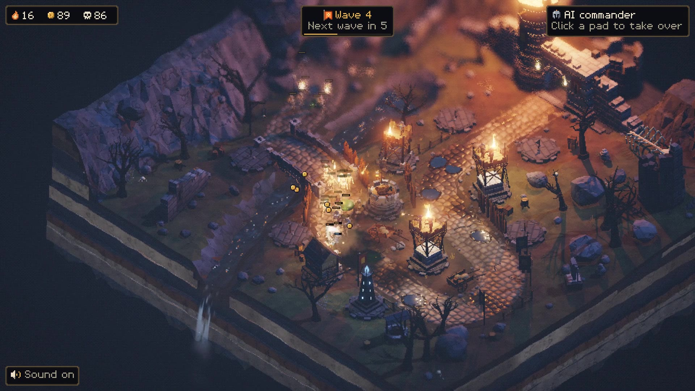
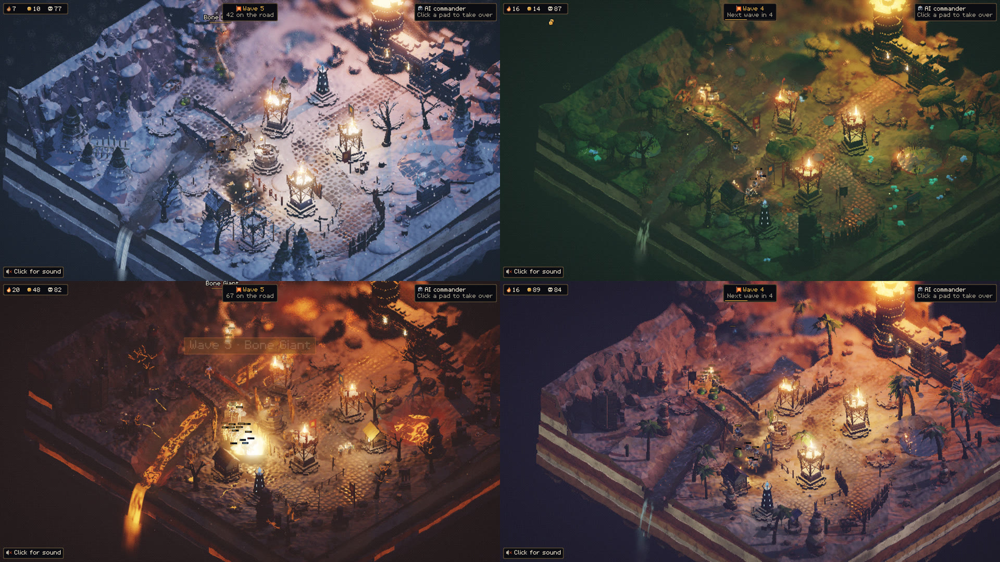
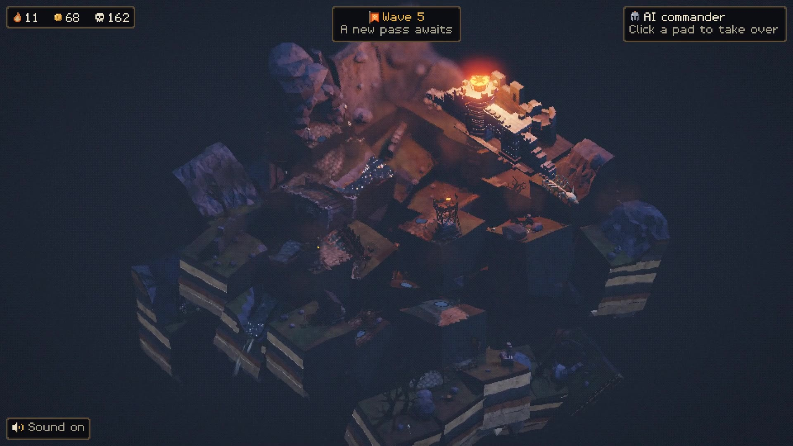

# Cinderwatch

A self-playing 3D isometric tower defense in a single HTML file.

A handful of firelit towers hold the great beacon of a ruined keep against endless columns of monsters, across five lands from a dark mountain pass to a snowfield, a bog, a lava scar and a desert at dusk. An AI commander plays from the moment the page loads, and you can take over at any time.

**[Play it in your browser](https://kevintngo.github.io/cinderwatch/)** · [Watch 20 seconds of gameplay](https://kevintngo.github.io/cinderwatch/media/gameplay-20s.mp4)



## What is in it

- **Four towers, three levels each**, raised piece by piece inside scaffolding: archer tower, bombard, storm spire and guard post.
- **Twenty kinds of monster**, each with its own model and trick. Skeletons, giant rats, slimes that split, shield-bearing knights and bats are joined by:
  - ghouls that run faster as they are hurt, dire wolves, and cave spiders and scarabs that slip past the guards
  - sappers whose powder keg blows up friend and foe, and wraiths that arrows and swords pass through while they fade
  - war drummers that speed up everything near them, and necromancers that raise more skeletons
  - bog toads, mummies that burst into scarabs, and brood mothers that burst into spiders
  - trolls that heal, stone golems that shrug off arrows, and gargoyles and glowing wisps in the air
- **A boss on every fifth wave, one per land**: the Bone Giant, the Frost Jotun that freezes towers, the Brood Queen, the Magma Colossus and the Buried King, with the Ogre waiting on a second visit to Ashen Pass. Each land also favors its own monsters, and tints some of them to match.
- **Battlefields that rebuild themselves.** After each boss the slab crumbles away and a new one, with a different road, assembles out of the dark.
- **Five lands.** Each new battlefield is in the next one: Ashen Pass, Frostfall (snow, a frozen stream and falling snow), Mirefen (bog pools, willows, glowing mushrooms and fireflies), Emberscar (a lava river, charred trees and ash) and Duskmesa (dunes, palms and an oasis). A page opened without a seed starts in a random one.
- **Light as the main character.** A flickering beacon, a brazier on every tower, flaming arrows, cannon flashes and chain lightning, with moving shadows.
- **A miniature look.** The scene is drawn at about half resolution, then given an ordered dither, a depth-aware tilt-shift blur, a vignette and film grain.
- **No asset files.** Every model, texture and sound is generated in code.
- **Small comforts.** The first time each monster appears, a line says what it does. Tower menus show what the next level brings. The wave plate shows the gold for calling a wave early. Your best wave and your mute setting are remembered.





## Controls

The game needs no input. Your first command puts you in charge, and the AI commander stays out until you hand the battle back.

| Input | Action |
| --- | --- |
| Hover a pad or tower | Highlight it and show its range |
| Click or tap an empty pad | Open the build menu |
| Click or tap a tower | Upgrade or sell |
| `1` to `4` | Pick a tower kind |
| `U` | Upgrade the hovered or selected tower |
| `X` | Sell the selected tower (press twice, or click Sell twice, to confirm) |
| `Space` | Call the next wave early |
| `C`, or click the commander plate | Hand command back to the AI, or take it |
| `M` | Mute (remembered for next time) |
| `P` | Pause; you can still look around and build |
| `Tab` | Game speed: 1x, 2x, 3x |
| Mouse wheel or trackpad pinch | Zoom toward the pointer |
| `+` and `-`, or the buttons in the corner | Zoom in and out |
| Drag the ground, arrow keys or `W` `A` `S` `D` | Move the view |
| Double-click the ground | Zoom in there; again to zoom back out |
| `F`, `0`, or the Follow the fight button | Hand the view back to the camera |
| `Esc` | Close the menu |
| Gamepad | Stick or D-pad selects a pad, A opens and confirms, B closes, X upgrades, Y calls the next wave |

Browsers keep audio off until a gesture, so the first click, tap or key press turns the sound on.

### On a phone or tablet

The game plays in portrait and in landscape, and follows the screen when it turns.

| Touch | Action |
| --- | --- |
| Tap an empty pad | Open the build menu |
| Tap a tower in the menu | Show what it does and its range; tap it again to build |
| Tap a built tower | Upgrade, or sell (sell asks for a second tap) |
| Tap the wave plate | Call the next wave early |
| Tap the commander plate | Hand command back to the AI, or take it |
| Drag | Move the view |
| Pinch, or the + and - buttons | Zoom, out to the whole battlefield |
| Double-tap the ground | Zoom in there; again to zoom back out |
| Follow the fight | Hand the view back to the camera |
| The buttons along the bottom | Pause, game speed, sound, zoom and, where the browser allows it, full screen |

The layout keeps clear of notches and home indicators, buttons are sized for fingers, the screen is asked to stay awake while the game is open, and sound stops when the page is in the background. Added to the home screen, it opens full screen.

The browser's own double-tap and pinch zoom are turned off on the page, so the view can never get stuck zoomed in; zooming is done by the game, and every way in has a way back out.

Touch was tested with Chrome's phone emulation, not on real phones. Gamepad input has not been tested on real hardware.

## Run it

Open `index.html`. It works from `file://` with no server, no build step and no network.

## Build it

```bash
python3 tools/build.py
```

This joins `src/*.js` into `index.html` and inlines three.js from `vendor/`.

## Layout

| Path | Contents |
| --- | --- |
| `index.html` | The built game |
| `src/00-util.js` | Math, random numbers, noise |
| `src/10-gfx.js` | Procedural textures, the lit material, the geometry builder |
| `src/20-post.js` | Renderer and post-processing |
| `src/29-biome.js` | The five lands: palettes, light, weather and water settings |
| `src/30-layout.js`, `31-terrain.js`, `32-props.js`, `33-flora.js` | Road, stream and pad layout, terrain, scenery, plants and props of each land |
| `src/40-fx.js`, `41-weather.js` | Lights, particles, lightning, decals, snow, ash, dust and fireflies |
| `src/50-rig.js`, `51-bestiary.js` | Characters built from instanced parts, debris, the models of the later monsters |
| `src/60-towers.js`, `61-monsters.js`, `62-game.js` | Towers, monsters and the crowd, waves and the AI commander |
| `src/70-pixelfont.js`, `72-ui.js` | Pixel font, HUD, menus, input |
| `src/80-audio.js` | Synthesized sound |
| `src/90-main.js` | Camera and main loop |
| `tools/` | Build script and test tools |

## Development tools

Both tools drive headless Chrome and need Node 22 or newer. Set `CHROME` if Chrome is not in the default macOS location, and `FFMPEG` if `ffmpeg` is not on your path.

```bash
node tools/cdp.js "seed=4&ff=30" wait:2000 shot:battle eval:"__cw.G.lives"
```

`cdp.js` runs the game in real time and accepts `wait`, `shot`, `eval`, `click`, `move` and `key` steps. Screenshots go to `tools/shots/`. With `MOBILE=1` (and `DPR=3` for a phone's pixel density) it emulates a touch screen of the given size and also accepts `tap`, `drag`, `pinch`, `rotate` and `safe` steps:

```bash
MOBILE=1 DPR=3 node tools/cdp.js "seed=4" 390,844 wait:2000 tap:195,500 shot:phone rotate:844,390 shot:phone-wide
```

```bash
node tools/record.js scan 4 200
node tools/record.js capture 4 5130-5490,9870-10230 out.mp4
```

`record.js` steps the game at a fixed 1/60 s, so a seed always replays the same way. `scan` logs what happens when, `stills` saves frames, and `capture` writes a video of the given frame ranges with the game's own audio.

URL flags, for example `index.html#seed=4&fps=1`:

| Flag | Effect |
| --- | --- |
| `seed=N` | Fix the battlefield and the run (starts in Ashen Pass) |
| `biome=NAME` | Start in `ashen`, `frost`, `fen`, `ember` or `dunes` |
| `level=N`, `k=N` | Start at a later battlefield or wave |
| `ff=S` | Fast-forward S seconds before the first frame |
| `fps=1` | Show frame rate and draw calls |
| `nodof=1` | Turn off the tilt-shift blur |
| `noscale=1` | Turn off automatic resolution scaling |
| `noopt=1` | Refresh every shadow map every frame and blur every pixel, for comparing speed |
| `manual=1` | Do not start the loop (used by `record.js`) |

## License

[MIT](LICENSE). The build includes [three.js](https://threejs.org) r170, also MIT ([notice](vendor/LICENSE-three.txt)).
